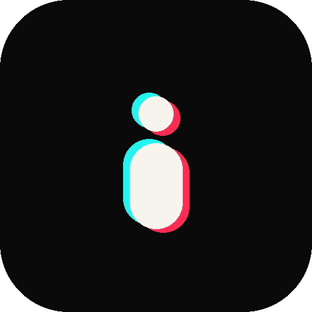
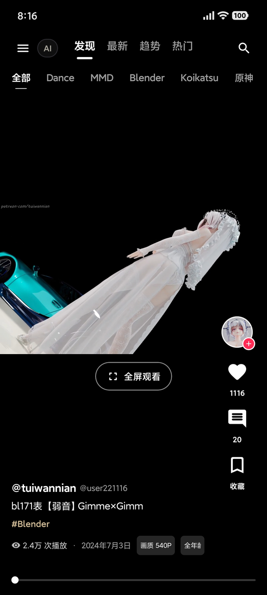
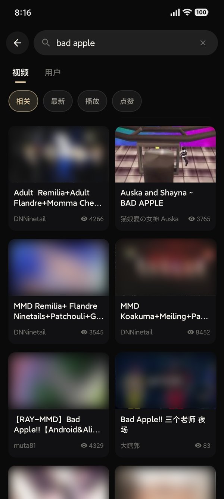

<div align="center">



# IwaRok

**非官方 Iwara Android 视频流客户端**

当前版本 **1.0** · 最低 Android 8.0（API 26） · 目标 API 35

[](LICENSE)
[](#环境要求)
[](#技术栈)
[](#技术栈)
[](#技术栈)

</div>

> [!IMPORTANT]
>
> **AI 辅助生成说明：** 本项目的部分代码、界面文案和文档在开发过程中使用了 AI 辅助生成与修改，并经过维护者审阅和整理。AI 生成内容可能存在错误、遗漏或不准确之处，使用前请自行判断；欢迎通过 Issue 或 Pull Request 指出问题。

> [!WARNING]
> **非官方项目。** 本项目仅供学习与个人参考，与 Iwara 官方无任何隶属、合作或授权关系，且不托管任何内容。Iwara 名称、商标及平台内容归其各自权利人所有。本项目仅面向年满 18 周岁的用户。

---

## 目录

- [项目简介](#项目简介)
- [功能](#功能)
- [技术栈](#技术栈)
- [环境要求](#环境要求)
- [构建](#构建)
- [项目结构](#项目结构)
- [免责声明](#免责声明)
- [鸣谢](#鸣谢)
- [许可证](#许可证)

## 项目简介

IwaRok 是一个面向 Android 的第三方 Iwara 视频流客户端，提供类似短视频应用的沉浸式浏览体验。主要能力包括竖向视频流、播放器控制、评论、收藏、关注、搜索、标签频道、历史记录等。项目不托管、不分发任何媒体内容，所有内容来自 Iwara 平台。

<p align="center">
  
  
</p>


## 功能

- 竖向全屏视频流，支持手势切换
- 发现、最新、趋势、热门排序
- 标签自定义与筛选，视频与用户搜索
- 视频详情、作者主页与相似视频
- 评论、回复、点赞、关注
- 本地收藏与历史记录

## 技术栈

| 类别 | 使用 |
| --- | --- |
| 语言 | Kotlin |
| UI | Jetpack Compose、Material 3 |
| 播放器 | AndroidX Media3 / ExoPlayer |
| 网络 | OkHttp |
| 图片 | Coil |
| 序列化 | kotlinx.serialization |
| 存储 | DataStore、EncryptedSharedPreferences |
| 构建 | Gradle 8.11、Android Gradle Plugin 8.7 |
| 测试 | JUnit 4、kotlinx.coroutines-test |

## 环境要求

- JDK 17
- Android Studio，或 Android SDK 35
- 最低 Android 8.0（API 26），目标 API 35

## 构建

```bash
git clone <repository-url>
cd IwaRok
./gradlew assembleDebug
```

Windows：

```powershell
gradlew.bat assembleDebug
```

调试 APK：

```text
app/build/outputs/apk/debug/app-debug.apk
```

构建前请通过 Android Studio 或 `local.properties` 配置 Android SDK 路径；`local.properties` 不应提交到仓库。

Linux / macOS 如果 `gradlew` 没有执行权限：

```bash
chmod +x gradlew
```

## 项目结构

```text
app/src/main/java/iwarok/app/
├── core/     数据模型、配置、格式化
├── data/     网络请求、认证、播放地址解析、设置存储
└── ui/       Compose 界面、播放器、主题、工具
```

应用 ID：`iwarok.app`

## 免责声明

- **项目性质**：本项目不是 Iwara 官方客户端，与 Iwara 官方无隶属、合作或授权关系。本项目面向年满 18 周岁的用户，未成年人请勿使用。
- **责任**：使用本项目可能受你所在地区的法律、Iwara 服务条款及内容授权约束。是否使用、如何下载和保存内容，由你自行判断并承担全部责任。请自行保管账号、密码和 Token。因账号共享、泄露、代理配置或第三方抓包导致的问题，由使用者自行承担。
- **内容版权**：视频、图片、评论、标签及其他平台内容的版权归原作者和 Iwara 所有；本项目不主张任何内容权利。请勿将下载内容用于侵权传播、商业分发或其他违法用途。
- **使用风险**：因使用或无法使用本软件造成的账号封禁、数据丢失、设备问题或其他损失，项目作者不承担赔偿责任。

## 鸣谢

- [Iwara](https://www.iwara.tv/)：内容与平台
- [XuexGao/iwara-web-proxy](https://github.com/XuexGao/iwara-web-proxy)：API 行为、签名方式和播放源解析参考
- AndroidX、Kotlin、Media3、OkHttp、Coil 等开源项目及其贡献者

第三方依赖和参考项目的许可证声明见 `NOTICE`。

## 许可证

本项目代码采用 **MIT License**，见 [LICENSE](LICENSE)。

Iwara 名称、Iwara 内容及相关商标不包含在本项目的 MIT 许可范围内。
